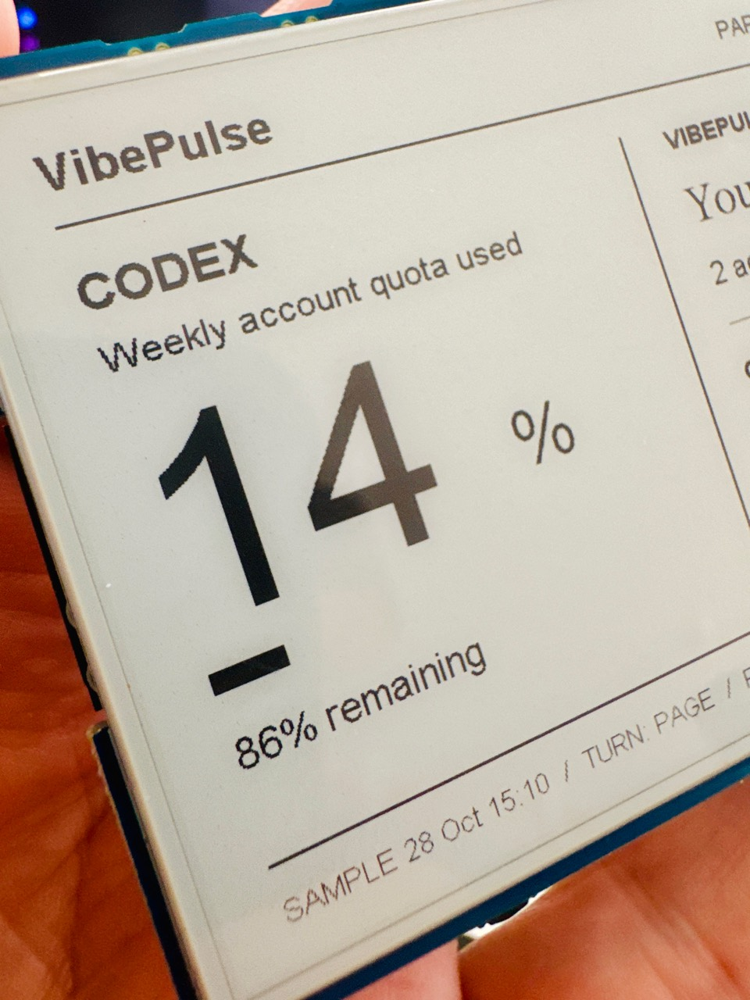
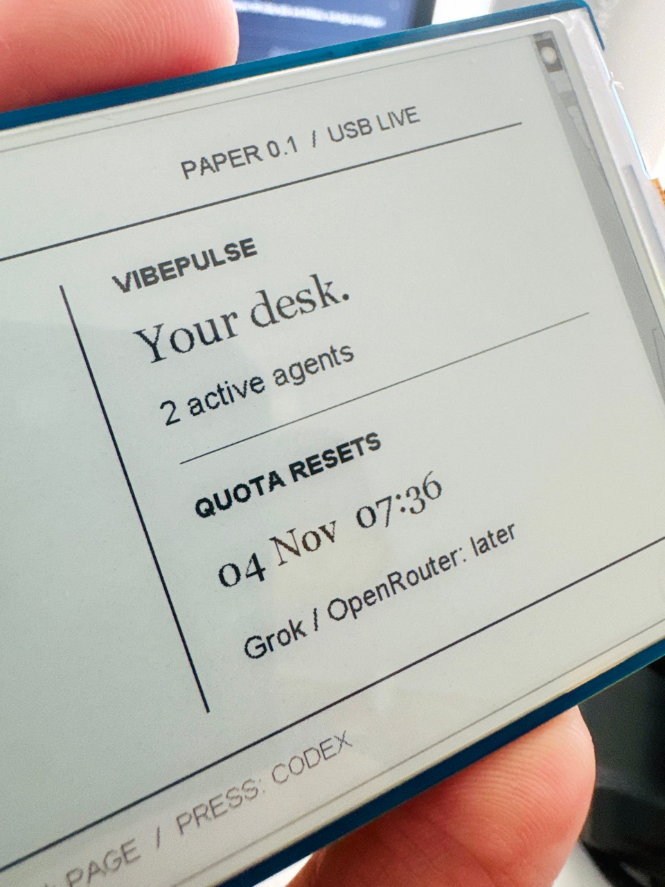

# 3.97 e-paper USB physical checkpoint — 28 October 2026

One owner unit, `epaper-397-01`, SKU 33811; PCB revision unknown. Host: macOS,
USB cable. Private ROM identifiers and full-flash backups remain private.

The owner authorized bring-up, confirmed a correct live Codex quota page and
page switching, and supplied these actual photographs. They show the earlier
`paper-0.1.1` checkpoint, **not** a photograph of the subsequent candidate.
JPEG metadata was removed without changing the compressed image data or decoded
pixels. [Media provenance](../img/epaper397/photos.json).

The 14% reading and two-agent count are historical observations, not current
website telemetry or a per-project cost. No live source payloads are published.

## Evidence by revision

| Revision | Result |
| --- | --- |
| Factory | Full 16 MB read and device digest verification passed before replacement; original app descriptor matched the model |
| `paper-0.1.0` | Build/write hashes/USB CRC ACK passed; **physical image failed**. Simple vendor example omitted panel power |
| `paper-0.1.1` | Factory ALDO3 power path added without charger configuration; owner confirmed image/orientation; source reader first-poll bug fixed; owner confirmed real 14% Codex value and navigation |
| `paper-0.2.0` | Dedicated repository target, licensed bundled fonts, native tokenserver source, no-redraw heartbeat and retained-baseline partial refresh. Written app hash verified; matching frame ACK reported about 0.63 seconds. Owner explicitly confirmed correct picture and quieter page changes |

The first-poll defect occurred because the old macOS Python monotonic clock
started near zero. Initializing the previous sample time to zero skipped the
first read. A regression drives the first transfer with monotonic time zero
and verifies a real synthetic quota is encoded, not an empty reading.

Unchanged-source regression: advancing observation time while preserving quota,
reset and state does not change the content key. Stale/value transitions do.
The host continues USB heartbeats without consuming a panel refresh.

**Passed scope:** USB data path, physical static orientation/readability,
Codex quota, basic switch navigation, and owner-observed quieter partial
refresh on this named unit. Driver ACK and automation remain separate from
human evidence. The default full-refresh budget is ten partial changes.

**Still open:** extended stability, measured ghosting, source failure/recovery
on the physical unit, cable/sleep/resume lifecycle, battery/charging, audio,
Wi-Fi/OTA, sensors/storage, remote decisions and physical Windows/Linux hosts.
No product-wide or regulatory certification is asserted.

## Final repository candidate

Application SHA-256 (local ESP-IDF build, no private configuration):
`44889c1e54925c51951d2a6d36f8eb7d8fe9d3a48bab0c427c6cac8b38940837`.

Live `paper-0.2.0` protocol checks rejected bad frame lengths and CRCs,
returned a no-redraw heartbeat acknowledgement, and resynchronized identity.
A resume heartbeat requests a repaint if the offline page had been drawn.
The portable host has regression coverage for empty/invalid/future/stale
readings, first poll at monotonic zero, unchanged-content suppression and
native 800×480 frame serialization.
