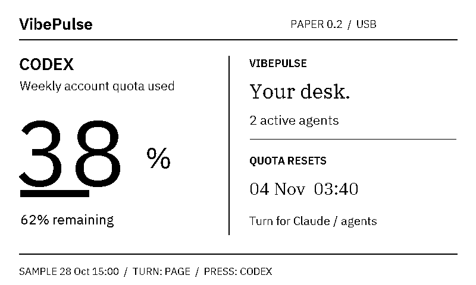

# VibePulse Paper — Waveshare 3.97-inch e-paper USB edition

A light, quiet VibePulse display for your desk. This dedicated **800 × 480
black-and-white USB edition** shows Claude/Codex weekly quotas, reset times and
agent activity from the existing VibePulse tokenserver. Rotate the three-way
switch to change pages; press it to return to Codex.



**Development edition, physically checked on one Mac-connected unit.** The
owner confirmed live Codex data, orientation, navigation and the quieter
partial refresh in `paper-0.2.0`. Claude with no source shows a dash. This is a
separate ESP-IDF target inside VibePulse, not an LVGL/AMOLED profile or the
independent Codex Usage Pulse plugin. It does not need that plugin.

## Exact hardware and boundaries

The package label was **ESP32-S3-ePaper-3.97-Kit, SKU 33811**. The original
flash identified its app as `ESP32-S3_ePaper-3.97`, version `1`, ESP-IDF
`v5.4.1`. The ROM reported ESP32-S3 revision v0.2, 16 MB flash and 8 MB PSRAM.
PCB revision remains unknown. USB VID/PID alone cannot establish the model.

| Checked on the physical unit | Not qualified or not implemented |
| --- | --- |
| Native image/orientation; live Codex quota; page changes | Battery/charging, audio/microphone, sensors, TF card |
| USB identity, frame CRC and refresh ACK | Wi-Fi/OTA, touch, remote approval/answer loop |
| PMU ALDO3 panel power; quieter partial refresh | Windows/Linux physical host tests, long soak, quantified ghosting |

Grok/OpenRouter are not implemented in this edition. Other VibePulse profiles'
Grok preview and Labs features do not imply e-paper support. See
[the model registry](../spec/boards/waveshare_epaper_397/hardware.md) and
[physical evidence](reviews/2026-10-28-epaper397.md).

## Run the Mac host

First get the normal [VibePulse tokenserver](agent-setup.md) working. This
reader never installs, restarts or reconfigures it. With the USB-edition
firmware already installed on the exact identified board:

```sh
python3.12 -m venv .venv-paper
.venv-paper/bin/python -m pip install -r tools/epaper397/requirements.txt
.venv-paper/bin/python -m tools.epaper397.usb_host --port /dev/cu.usbmodemYOUR_PORT
```

Use your own port; do not copy someone else's USB identifier. Omitting `--port`
selects a single Espressif candidate; several candidates require an explicit
choice. The host also requires the exact firmware/model/protocol greeting
before sending any raster. The default source is `http://127.0.0.1:8737`;
`--url` selects an existing tokenserver. No API keys, external provider calls,
network listener or login startup are added. The Mac must remain awake.
`Ctrl-C` stops an interactive bridge. Preview/status files go to
`~/.vibepulse-paper`, or a directory supplied with `--state-dir`.

## Why it no longer blinks every minute

The host polls the source every 30 seconds. A new observation time alone does
**not** redraw the panel: it sends a USB heartbeat while preserving the pixels.
Changed visible values, page selections and stale/unavailable transitions
trigger a raster. The displayed SAMPLE time belongs to that visible reading;
it is not a continuously advancing clock.

The controller keeps power and baseline RAM between updates. Startup and each
refresh after ten partial updates use a full refresh; intervening content
changes use the vendor's partial waveform. Full refresh can visibly flash and
is intentional ghosting cleanup. The ten-update budget is an initial
conservative policy, not a measured lifetime/ghosting guarantee. The owner
confirmed that page changes look quieter; measured ghosting and long soak
remain open. USB operation does not establish battery endurance.

After 120 seconds without a host frame/heartbeat the firmware draws an offline
page. Unplugging all power may leave the previous image indefinitely: e-paper
pixels are not a proof of liveness. Unknown quota is a dash, not zero; cached
values older than 180 seconds are labeled stale.

A board restart invalidates the host's cached raster and repaints even an
unchanged Device page. An interrupted transfer without a matching ACK repeats
the firmware identity handshake; queued startup greetings do not discard a
valid raster ACK. Reset minutes are anchored to the token HTTP snapshot,
which is retained between reads; the age of a cached quota observation does
not move its reset deadline.

## Build and installation

Use ESP-IDF **v5.5.2** (the CI version) and this explicit target. It does not
include companion apps or require `secrets.h`:

```sh
. "$HOME/esp/esp-idf/export.sh"
idf.py -C firmware/epaper_397 -DIDF_TARGET=esp32s3 reconfigure
cmake --build firmware/epaper_397/build --parallel 2
```

The build embeds only public boot/offline rasters, no Wi-Fi credentials.
Installation still replaces the selected device's application. Before the
first install: confirm the exact model/PCB marking and intended USB unit,
inspect native fixtures, record the current app and flash/security identity,
read and digest-verify a **private full-flash backup**, and preserve a recovery
path. Do not infer model/revision from Espressif USB IDs. Do not erase NVS or
change eFuses. Read the generated `flash_args` before authorizing an install;
use the confirmed port and the files from this build only.

For an explicitly authorized first install, the project can then use:

```sh
idf.py -C firmware/epaper_397 -p /dev/cu.usbmodemYOUR_PORT flash
```

Do not run that as a discovery command. On the owner's unit, the original
16 MB backup was verified before writing the bootloader, partition table and
application. Later pilot updates wrote only the application at `0x10000`.
Backups and private device identifiers are never included in the repository.

After installation, separate write-hash verification, the `paper-0.2.0` USB
greeting, CRC-matching ACK, actual fresh source values, human inspection of the
image and human button/navigation checks. An ACK alone is not physical proof.

## Development checks

```sh
python -m unittest discover -s test -p test_epaper397.py -v
python tools/hardware_registry.py spec/boards/waveshare_epaper_397
```

The full host gate includes these tests; CI builds the dedicated firmware and
runs the portable source/renderer tests on macOS, Windows and Ubuntu. Those
runners are automated portability evidence, not physical host qualification.
Bundled IBM Plex fonts carry their OFL license and pinned source hashes.

## Implementation notes

- SPI3: SCK 11, MOSI 12, CS 10, DC 9, RST 46, BUSY 3.
- Three-way switch: up 4, press 5, down 6; active low.
- Shared I2C: SDA 41, SCL 42; TG28/AXP2101-compatible PMU at `0x34`.
- ALDO3 is the panel rail. Check chip ID `0x4a`, set 3.3 V preserving register
  upper bits, verify voltage/enable readback. Charger registers are untouched.
- The simple vendor example omits ALDO3 control; the factory example includes
  it. Omitting it produced ACKs without visible pixels in the first pilot.
- Frames are 48,000 bytes, MSB first, 1 = white. VPP1 + three little-endian
  uint32 fields (sequence, length, CRC32) precedes the frame. `!` is a
  no-redraw host heartbeat; `?` requests identity. Length/CRC/timeouts reject
  a frame. BUSY waiting is bounded at 30 seconds.
