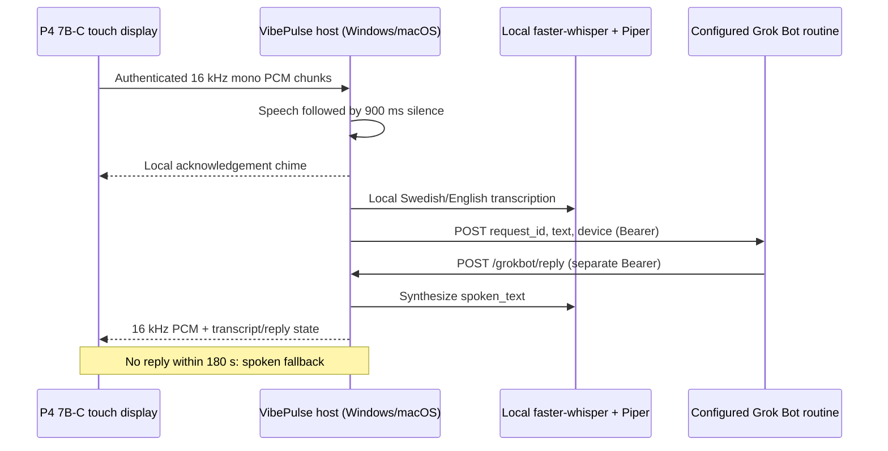
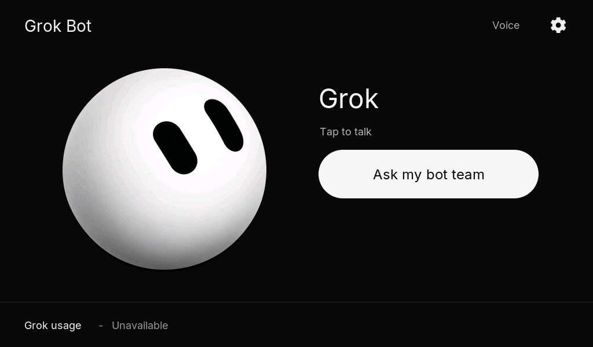
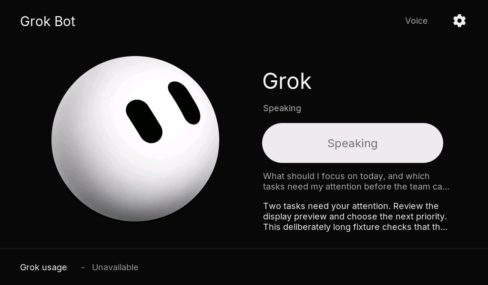

# Voice: Ask my bot team

An opt-in voice workflow inside VibePulse for **Waveshare ESP32-P4-WIFI6-Touch-LCD-7B-C**, SKU 32511. Tap once, speak Swedish or English, then let the host detect the end of speech. The display shows Listening, Thinking, Speaking, the transcript and the bot reply. Audio is half duplex: the microphone closes before the acknowledgement and reply play.

This is a routine-webhook integration, **not a Grok Bot voice call**. It does not read desktop app credentials, automate the app, discover bots through private APIs, or call internal voice functions. The routine decides how to consult the user's bot team.



## Host setup

1. Use the existing VibePulse Python environment (Python 3.12 recommended) on Windows or macOS. Install the optional dependencies:

   ```sh
   python -m pip install -r requirements-voice.txt
   ```

2. Download a multilingual faster-whisper model to local storage if offline operation is required. Set `VIBEPULSE_STT_MODEL` to that directory, or to a model name such as `small` (the first use downloads model weights). Do not choose an `.en` model for Swedish. `VIBEPULSE_STT_LANGUAGE=auto` detects Swedish/English; use `sv` or `en` to force a language.

3. Download a Swedish Piper voice such as `sv_SE-nst-medium.onnx` **and its matching `.onnx.json`** using Piper's voice download tools. Review the voice model's license. Set `VIBEPULSE_PIPER_MODEL` to the absolute local ONNX path. Piper runs locally; cloud TTS is off unless `VIBEPULSE_TTS=elevenlabs` is explicitly selected. The optional adapter reads `ELEVENLABS_API_KEY` and `ELEVENLABS_VOICE_ID` from the environment and sends only reply text to ElevenLabs.

4. Copy `.env.example` to a private `.env` here and replace placeholders locally. This file is not automatically loaded: supply those variables to the existing service process using your private environment loader/service configuration. Do not put tokens into shell history, task arguments, logs or tracked configuration. Use independent high-entropy webhook, reply and device tokens.

5. Configure a **supported routine webhook** that accepts the contract below. Put its HTTPS URL and Bearer credential into `GROKBOT_WEBHOOK_URL` and `GROKBOT_WEBHOOK_KEY`. The host does not discover, create or modify routines. It makes one POST, without redirect following or automatic retries. Configure the routine to call the reply endpoint after its team finishes.

6. Append `--grok-voice` to the existing host's arguments, preserving every current option. For a foreground development instance on another port:

   ```sh
   python tools/tokenserver/tokenserver.py --port 8738 --grok-voice
   ```

   Nothing in this project changes or restarts a running service. Without the flag, all voice routes return 404 and no speech dependencies are imported. macOS launchd and Windows Task Scheduler must receive the environment variables in their own process environment; a terminal's exports do not update an already running service.

## Webhook and callback contract

Outbound request: JSON `{request_id, text, device}`, authenticated with `Authorization: Bearer <GROKBOT_WEBHOOK_KEY>`. `request_id` is a host-generated UUID. `device` is a configured display identifier, not a user's account or bot ID. The routine URL can itself be sensitive and is never logged. Only the transcript goes to the routine; microphone PCM stays between display and host.

The routine must send `POST /grokbot/reply`, `Content-Type: application/json`, and `Authorization: Bearer <VIBEPULSE_REPLY_TOKEN>` with:

```json
{
  "request_id": "THE_REQUEST_ID_FROM_THE_TRIGGER",
  "spoken_text": "A concise answer to read aloud.",
  "status": "completed"
}
```

`status` accepts `completed` or `error`; `spoken_text` is required and limited to 2,000 characters. Unknown requests return 404; duplicate replies return 409; expired requests return 410. Tokens are compared in constant time. A device token cannot submit a routine reply. A 200 callback response means accepted for synthesis, not that playback succeeded.

The Bearer routine contract is operator supplied. This feature does not claim that every Grok automation product uses it. In particular, the separate [Grok automation webhook documentation](https://docs.x.ai/grok/automations/webhooks) describes HMAC signing; that is a different contract and is not silently substituted here. No live routine endpoint has been tested in this change.

If the routine runs outside the LAN, provide a TLS reverse proxy/tunnel that forwards **only `POST /grokbot/reply`** to the host and preserves Authorization. Do not publish the tokenserver port or its other unauthenticated quota routes. External reachability is a deployment prerequisite, not created by this code. Device traffic uses a trusted private LAN; use HTTPS with a trusted certificate for untrusted networks. Plain LAN HTTP does not encrypt audio or the device token.

## Device build and provisioning boundary

This dedicated P4 project leaves the existing S3 targets unchanged. It pins Waveshare BSP 3.0.1, LVGL 9.5.0 and ESP Wi-Fi Remote 1.2.5. The component lock file records transitive versions. The C6 coprocessor must already run compatible ESP-Hosted firmware; this project never reflashes it.

Use ESP-IDF 5.5.5 where available. The development build also supports installed 5.5.2 with `CONFIG_HAL_WDT_USE_ROM_IMPL` disabled for P4 revision 3.2, following [Espressif AR2026-004](https://documentation.espressif.com/AR2026-004_Compatibility_Advisory_for_ESP32-P4_Chip_Revision_v3.2_EN.html). Keep Windows checkout/build paths short to avoid third-party component path-length failures.

```sh
cd projects/grok_bot/firmware
idf.py build
```

For a physical touch investigation, enable `GROK_TOUCH_DIAGNOSTICS` in
`idf.py menuconfig` under **Grok panel diagnostics**. This prints touch read
status and coordinates over USB serial; it is disabled in normal builds.

The build command never flashes a device, and the binaries contain no configured credentials. The owner subsequently authorized a local UI preview on 2026-10-27; see docs/preview-validation.md for that separate installation and its remaining touch/audio acceptance limits. Before a separately authorized installation, provision NVS namespace `grok_voice` with string keys `ssid`, `password`, `url` (host origin, no trailing slash), `token` (the device token), and `device` (letters/digits/underscore/hyphen, max 64). The host's webhook and reply secrets must never go on the display. Missing configuration shows Setup needed. Provisioning and physical acceptance remain separate; do not distribute private NVS images or configured firmware.

Tap-to-talk is implemented. An always-listening wake word is **not enabled or bundled**: no wake-word model, continuous audio upload or camera tracking is present in this version. It can later call the same capture entry point after an explicit opt-in and hardware validation. There is no fake active call or call-duration counter.

## Protocol and limits

All device routes require `VIBEPULSE_VOICE_TOKEN` as Bearer:

| Route | Purpose |
| --- | --- |
| `POST /grokbot/session` with `{device}` | Admit an utterance and return request ID |
| `POST /grokbot/audio/<id>/<sequence>` | Ordered raw PCM s16le, 16 kHz mono; at most 6,400 bytes |
| `GET /grokbot/session/<id>` | State, transcript, reply, next audio version |
| `GET /grokbot/playback/<id>/1` | Local acknowledgement PCM |
| `GET /grokbot/playback/<id>/2` | Reply/fallback PCM |
| `POST /grokbot/played/<id>` with `{}` | Confirm playback, clear audio |

The P4 sends 100 ms packets; an 800 ms queue keeps I2S sampling independent of HTTP latency. Network overload aborts instead of silently dropping PCM. The host uses 20 ms energy windows plus trailing silence; faster-whisper applies its own VAD before transcription. Tune `VIBEPULSE_VOICE_ENERGY` for microphone gain/noise and `VIBEPULSE_VOICE_SILENCE_MS` for pauses.

Defaults: 10 admitted attempts/hour across devices, two active sessions, four retained sessions, 30 s maximum recording, 8 s no-speech cutoff, 5 s missing-packet cutoff, 180 s response deadline from end of speech, and 120 s maximum synthesized audio. The hourly attempt limit is configurable and in memory; restarting the host resets it. Audio/transcripts are memory-only except private temporary files during local speech processing; terminal sessions are purged after 60 s. The host records no keys, PCM or transcript logs. Exceptions from providers are converted to fixed error codes.

## Latency and verification

Budget roughly 0.9 s for end-of-speech detection, plus local STT, routine execution, and local TTS. Model loading happens in a bounded subprocess per utterance, which favors isolation over warm-model speed. Initial model downloads and cold starts can be slow; pre-download models before a demo. These are design expectations, **not measured physical latency**. The acknowledgement plays before STT finishes. If synthesis fails, the reply remains visible with Error rather than claiming successful speech.

A Windows CPU smoke test with a synthetic Swedish sentence passed using the
actual Piper and faster-whisper adapters: Piper took 8–11 seconds to produce
about 4 seconds of audio; Whisper `small` took 13 seconds and recovered the
sentence exactly. These include subprocess/model startup and exclude the
display, microphone and routine. They are not conversational quality or device
latency measurements. The optional requirements pin the tested speech engines
and PyAV 16.1.0: PyAV 19 removed a decoder argument used by faster-whisper 1.2.1.

Repeat this check before configuring a routine, with downloaded local models:

```sh
python projects/grok_bot/verify_local_speech.py --piper-model /path/sv_SE-nst-medium.onnx --stt-model /path/whisper-small
```

It synthesizes a fixed test sentence and checks the transcribed words without
opening a microphone, calling a webhook, or reading service credentials. It
prints only pass/fail and timing; it does not claim device acceptance.



This capture is rendered by the same LVGL UI sources as the firmware; it is not physical-panel acceptance.

The following **offline Speaking fixture** checks long-text clipping. It is not
a live call or routine reply. The simulator accepts explicit fixture arguments
as `grok-sim output.ppm Speaking "transcript" "reply"`; firmware never reads these.



Host tests use fake STT/TTS and a fake webhook; they exercise real HTTP routing and authentication without cloud credentials:

```sh
python -m unittest tools.tokenserver.test_grok_voice
```

The module is registered in `test/tokenserver-suite.txt`. Full target-build and test evidence belongs in the PR. Microphone channel routing, speaker levels, Wi-Fi stability, touchscreen behavior, Swedish recognition quality and end-to-end routine callbacks require later physical/live acceptance. No hardware PASS is inherited from another VibePulse board.

Upstream speech interfaces: [faster-whisper](https://github.com/SYSTRAN/faster-whisper), [Piper](https://github.com/OHF-Voice/piper1-gpl).
